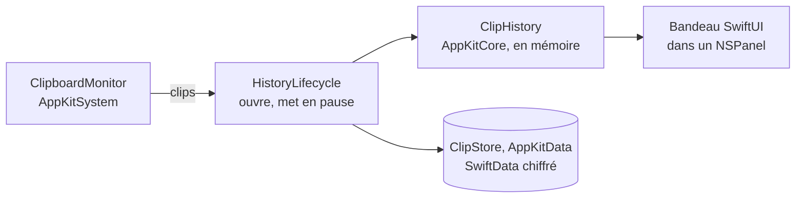

# Architecture

The macro technical shape: the stack, how the pieces fit, and the decisions behind them. Point to the code, do not restate it.

## Stack

- Swift en mode de langage Swift 6, isolation `MainActor` par défaut, concurrence « approachable ».
- SwiftUI pour toute l'interface, le framework AppKit d'Apple seulement pour ce que SwiftUI ne couvre pas.
- Projet Xcode (pas de Swift package à la racine) : Xcode gère la signature, les entitlements, les String Catalogs et l'icône.

## How it fits together

## Key decisions

- Hors App Sandbox, avec le chiffrement de l'historique comme protection principale des données : voir `aidd_docs/memory/internal/decisions/hors-app-sandbox.md`.
- Historique chiffré dans SwiftData, lu en mémoire par un objet `@Observable` avec un index de recherche contigu, jamais avec `@Query` : voir `aidd_docs/memory/internal/decisions/historique-chiffre-en-memoire.md`.
- App de barre de menus sans fenêtre principale ; le bandeau est un `NSPanel` non activant qui glisse depuis le bas de l'écran et passe par-dessus le Dock : il se place sur tout l'écran, pas dans la zone laissée aux fenêtres.

- 100 % Apple, avec une seule dépendance tierce validée : Sparkle 2, pour les mises à jour, dans la seule cible app. Toute autre exception se demande d'abord.
- Architecture MV à la manière d'Apple, rangée par feature, avec un cœur isolé dans des packages Swift locaux (`AppKitCore`, `AppKitData`, `AppKitSystem`) dont les dépendances vont vers le cœur : voir `aidd_docs/memory/internal/decisions/architecture-mv-feature-core.md`.
- Un objet `@Observable` suffixé `…ViewModel` seulement pour un écran qui porte de la logique propre, jamais par réflexe.
- Le rôle d'un type se lit à son suffixe, un type par fichier : voir `aidd_docs/memory/external/plugins-et-workflow/06-arborescence-et-nommage.md`.
- Les skills Apple `xcode-integration:*` font foi sur SwiftUI, Swift Testing, App Intents, l'accessibilité et la traduction.

## Gotchas

- `Intents/` n'existe pas encore : il arrive avec son premier fichier, jamais vide.
- Les packages locaux se compilent en `arm64e` grâce à `iOSPackagesShouldBuildARM64e` dans `WorkspaceSettings.xcsettings` : sans cette clé, l'app, en `arm64e`, ne les trouve pas. Avec Xcode 27.1, c'est bien la clé `iOS` qui agit aussi sur macOS.
- L'app s'appelle AppKit, comme le framework d'Apple. Son module Swift s'appelle donc `AppKitMain` (`PRODUCT_MODULE_NAME`), et `import AppKit` désigne toujours le framework. Aucun type ni package du projet ne s'appelle `AppKit` tout court : il masquerait le framework.
- `project.pbxproj` se modifie par les outils MCP Xcode ; seule exception, référencer un dossier ou un fichier racine.
- Avec Xcode ouvert, ne pas basculer git sur une ref qui n'a pas le projet : Xcode signale le workspace disparu.
