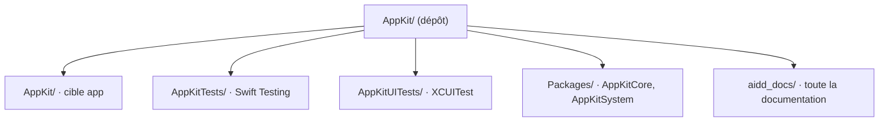

# Codebase Map

The macro layout: the top-level areas and what each holds. A map to navigate, not the full tree.

## Areas

- `AppKit/`: la cible app ; `App/` (démarrage et assemblage), `Features/` (`HistoryStrip`, `MenuBar`, `Settings`), `Shared/` (tokens de design, extensions), `Resources/` (assets, String Catalog).
- `Packages/`: le cœur isolé ; `AppKitCore` (types et historique en mémoire), `AppKitSystem` (presse-papiers et app au premier plan, derrière des protocoles).
- `AppKitTests/`: tests unitaires et d'intégration Swift Testing.
- `AppKitUITests/`: tests d'interface XCUITest.
- `aidd_docs/`: toute la documentation : mémoire, décisions (`memory/internal/decisions/`), guide des plugins et du workflow (`memory/external/plugins-et-workflow/`), brief, backlog, plans.

## Entry points

- `AppKit/App/AppKitApp.swift` : `@main` ; `AppKit/App/AppDelegate.swift` crée l'icône, le bandeau et lance la capture.
